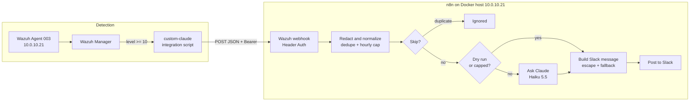

# ⚙️ SOC-AI-Triage
 


 
**A self-hosted pipeline that sends Wazuh alerts through n8n to Claude Haiku 5.5 and posts a short triage note to Slack. Alerts are redacted before they leave the network, deduplicated, rate-capped, and never silently dropped.**
 
Built for the 2026 Q4 Homelab Workshop by Bryan Perez - CyberSentinels (Miami Dade College), in partnership with the Claude Ambassador Program.
 
```
Wazuh Manager → custom-claude → n8n webhook → redact + dedupe + cap → Claude Haiku 5.5 → escape → Slack
```
 
---
 
## Design goals
 
1. **Treat alert data as untrusted.** Usernames, URLs and log lines come from whoever is attacking the host. Every field is redacted, stripped of structure-faking characters, and wrapped in `<alert>` tags before it reaches the model.
2. **Minimize what leaves the network.** Private IPs, hostnames, usernames and emails are replaced with labels (`HOST-1`, `EXTERNAL-IP-1`, `USER-1`) before the Claude call.
3. **Never fail silently.** If Claude errors, returns nothing, or the hourly cap is hit, the alert still reaches Slack, clearly labeled as un-triaged.
4. **Advisory only.** The model never triggers an action, and its prompt forbids suggesting automatic blocking or changes. Automated response lives in [`lab-soc-automation`](https://github.com/brypreez/lab-soc-automation).
5. **Control cost.** Level threshold in Wazuh, duplicate suppression, a hard hourly cap, and a small `max_tokens`.
---
 
## Architecture
 

 
> The Docker host also runs the observability stack. It is context for this project, not part of the alert path.
 
---
 
## Repository layout
 
```
SOC-AI-Triage/
├── README.md
├── LICENSE
├── .gitignore
├── ai-soc-analyst.n8n.json     # n8n workflow export (placeholders only, no secrets)
├── samples/
│   ├── wazuh.json              # made-up brute-force alert
│   └── wazuh-injection.json    # made-up alert with prompt-injection attempts
├── wazuh/
│   ├── ossec-integration.xml   # <integration> block (placeholders only)
│   └── custom-claude           # integration script
└── docs/
    └── img/                    # screenshots
```
 
---
 
## Quick start
 
### 1. Run n8n
 
```bash
docker run -d --name n8n --restart unless-stopped \
  -p 10.0.10.21:5678:5678 \
  -e WEBHOOK_URL=http://10.0.10.21:5678/ \
  -v n8n_data:/home/node/.n8n \
  docker.n8n.io/n8nio/n8n:<TESTED_VERSION>
```
 
- Bind to the lab VLAN address, not all interfaces.
- Pin `<TESTED_VERSION>` to the version you tested (not `latest`) so rebuilds are reproducible.
- `--restart unless-stopped` brings n8n back after a reboot. Containers without a restart policy stay in `Exited (255)`.
Open `http://10.0.10.21:5678` and create the owner account.
 
### 2. Create two credentials (Credentials → Create → Header Auth)
 
| Credential name | Header name | Value |
| :--- | :--- | :--- |
| `Anthropic API key` | `x-api-key` | your key from the Claude Console |
| `Wazuh webhook token` | `Authorization` | `Bearer <long random string>` |
 
### 3. Import the workflow
 
Workflows → Import from file → `ai-soc-analyst.n8n.json`, then:
 
- Open **Wazuh webhook** and **Ask Claude** and select the matching credential.
- Open **Post to Slack** and paste your Slack incoming-webhook URL.
- Open **Redact and normalize** and check `MODEL` against the Console model list.
- Leave `DRY_RUN = true` for the first run (see below).
> ⚠️ **The Slack webhook URL is stored in the node itself, not in a credential.** After pasting it, never export or commit this workflow. The copy in this repo contains a placeholder. Before any export, replace the URL with `PASTE-YOUR-SLACK-WEBHOOK-URL-HERE`.
 
### 4. Dry run, then go live
 
With `DRY_RUN = true`, Claude is never called. Slack receives the redacted alert exactly as it would be sent, which lets you verify redaction before anything leaves your network.
 
Activate the workflow, then test with the made-up samples:
 
```bash
curl -X POST http://10.0.10.21:5678/webhook/wazuh-alert \
  -H "Authorization: Bearer <your token>" -H "Content-Type: application/json" \
  -d @samples/wazuh.json
```
 
Check the Slack output, then set `DRY_RUN = false` and repeat. Also send `samples/wazuh-injection.json`: the note should rate the alert on its rule and level, not on the text in the log.
 
### 5. Wazuh integration
 
`/var/ossec/etc/ossec.conf` (also in `wazuh/ossec-integration.xml`):
 
```xml
<ossec_config>
  <integration>
    <name>custom-claude</name>
    <hook_url>http://10.0.10.21:5678/webhook/wazuh-alert</hook_url>
    <api_key>REPLACE_WITH_BEARER_TOKEN</api_key>
    <level>10</level>
    <alert_format>json</alert_format>
  </integration>
</ossec_config>
```
 
Wazuh passes the alert file as `$1`, `<api_key>` as `$2`, and `<hook_url>` as `$3`. Nothing is hardcoded in the script, and nothing depends on environment variables (which `wazuh-integratord` does not inherit). The real `<api_key>` stays on the manager, never in the repo.
 
> The `<api_key>` here must match the **value after `Bearer `** in the `Wazuh webhook token` credential.
 
`/var/ossec/integrations/custom-claude`:
 
```bash
#!/usr/bin/env bash
set -euo pipefail
 
ALERT_FILE="${1:-}"
API_KEY="${2:-}"     # <api_key> from ossec.conf
HOOK_URL="${3:-}"    # <hook_url> from ossec.conf
LOG_FILE="/var/ossec/logs/integrations.log"
 
log() { echo "$(date -Iseconds) [custom-claude] $*" >> "$LOG_FILE"; }
 
if [[ -z "$ALERT_FILE" || ! -f "$ALERT_FILE" ]]; then
  log "ERROR: alert file missing: ${ALERT_FILE}"
  exit 1
fi
 
if [[ -z "$HOOK_URL" || -z "$API_KEY" ]]; then
  log "ERROR: hook_url or api_key not provided by ossec.conf"
  exit 1
fi
 
HTTP_CODE=$(curl -sS -o /dev/null -w "%{http_code}" \
  --connect-timeout 5 --max-time 15 \
  -X POST "$HOOK_URL" \
  -H "Authorization: Bearer ${API_KEY}" \
  -H "Content-Type: application/json" \
  --data-binary "@${ALERT_FILE}") || HTTP_CODE="000"
 
log "POST ${HOOK_URL} -> HTTP ${HTTP_CODE} (file: ${ALERT_FILE})"
 
[[ "$HTTP_CODE" =~ ^2 ]] || exit 1
```
 
Deploy:
 
```bash
chown root:wazuh /var/ossec/integrations/custom-claude
chmod 0750 /var/ossec/integrations/custom-claude
systemctl restart wazuh-manager
```
 
Test the script directly (bypasses the level threshold):
 
```bash
/var/ossec/integrations/custom-claude samples/wazuh.json "<YOUR_TOKEN>" "http://10.0.10.21:5678/webhook/wazuh-alert"
tail -n 20 /var/ossec/logs/integrations.log
```
 
A single failed login (`ssh invalid_user@127.0.0.1`) is a level 5 event and will **not** be forwarded at the level 10 threshold. Repeat the attempt several times quickly to trip the brute-force rule, or temporarily lower `<level>` while testing.
 
---
 
## How the workflow behaves
 
| Node | What it does |
| :--- | :--- |
| **Wazuh webhook** | Receives the alert. Header Auth required. |
| **Redact and normalize** | Keeps only useful fields, replaces private data with labels, strips control characters, `<`, `>` and backticks from every value, builds the prompt, applies dedupe and the hourly cap |
| **Skip?** | Duplicates inside the dedupe window go to *Ignored* |
| **Dry run?** | Dry-run and capped alerts skip Claude and go straight to Slack |
| **Ask Claude** | Calls the Messages API (30 s timeout, 1 retry, continues on error) |
| **Build Slack message** | Uses the AI note or a labeled fallback, restores real values (optional), escapes Slack control characters |
| **Post to Slack** | Sends the Block Kit message |
 
Settings live at the top of the two Code nodes: `DRY_RUN`, `DEDUPE_SECONDS`, `MAX_CALLS_PER_HOUR`, `MAX_TOKENS`, `MODEL`, `KEEP_HOSTNAMES`, and in the Slack node `RESTORE_LABELS`.
 
### What Slack shows in each case
 
| Situation | Slack message |
| :--- | :--- |
| Normal | AI triage note, labeled "AI-generated, verify against the raw alert" |
| Claude error, timeout, or empty reply | ⚠️ "AI triage unavailable" plus the raw alert |
| Hourly cap reached | ⛔ "Not triaged: hourly cap reached" plus the raw alert |
| Duplicate inside the window | Nothing (intentional) |
| Dry run | The exact redacted text that would be sent |
 
### Labels vs. real values
 
Claude only ever sees labels. In Slack, `RESTORE_LABELS = true` swaps them back to the real hosts, IPs and users, since the note is useless to an analyst if it says "HOST-1". Set it to `false` to keep labels in Slack too.
 
---
 
## Security model
 
| Threat | Mitigation | Residual risk |
| :--- | :--- | :--- |
| Prompt injection via alert fields | Field allowlist, `<alert>` delimiters, system prompt declares content untrusted, newlines/`<>`/backticks stripped so fields cannot fake structure or close the tag, usernames replaced with labels | Delimiting reduces but does not eliminate injection. The output is advisory and triggers nothing. |
| Slack mention/link injection | `&`, `<`, `>` escaped before posting | Bare URLs may still auto-link |
| Data leaving the network | Redaction of private/public IPs, emails, hostnames, `srcuser`/`dstuser` | Best-effort. See limits below. |
| Runaway cost | Level threshold, dedupe, hourly cap, `max_tokens: 400` | Cap counts calls made, not dollars. Set a spend limit in the Console too. |
| Secrets in Git | Placeholders in the repo; keys in n8n credentials | Slack URL lives inside the workflow (see Quick start) |
| Unauthenticated webhook | Header Auth credential | Plain HTTP on the lab VLAN. Add TLS if it ever leaves it. |
 
### Redaction limits (read before using real data)
 
Redaction is pattern-based and best-effort, not a guarantee. Known gaps: IPv6 addresses and MAC addresses are not redacted; hostnames other than the alert's agent name are not recognized; usernames are only redacted when they appear in `srcuser`/`dstuser`. Use made-up data for demos and review a dry run before enabling this on real alerts.
 
### Operational notes
 
- **Dedupe and the cap use n8n static data**, which only persists while the workflow is **Active** (manual test runs don't count).
- **Concurrent alerts can slip past dedupe and the cap.** Static data is saved when an execution finishes, so a burst of simultaneous identical alerts may each pass. The cap is a soft limit.
- **The webhook answers immediately.** Wazuh's log shows `HTTP 200` once n8n accepts the alert, which does not prove Claude or Slack succeeded. Check n8n execution history for downstream failures.
- **Wazuh remains the system of record.** This pipeline is a notification layer.
---
 
## Status
 
<!--
TODO: update this section after your live run.
Suggested: date, n8n version, what you verified end to end (import, Claude call, Slack post,
dry run, injection sample, failure path, cap path).
-->
 
- Code-node logic (redaction, dedupe, hourly cap, fallbacks, Slack escaping) exercised in Node with mocked n8n inputs and the two sample alerts.
- **Not yet verified:** import into a live n8n, the real Claude call, the Slack post. Do a full dry run before relying on it.

## Sample output


---
 
## Lab context
 
The alert path runs on a ground-up homelab:
 
- **Virtualization:** Proxmox VE cluster
- **Container host:** Docker Engine on `10.0.10.21` with Portainer CE
- **Metrics:** Prometheus scraping Node Exporter and PVE Exporter
- **Logs and dashboards:** Loki and Promtail, visualized in Grafana
- **Detection:** Wazuh v4.14.8 (Agent `003` on the Docker host)
Hardware specs, the 3-node Proxmox HA layout, VLAN 10/20/40 segmentation and the Active Response baseline are in [`brypreez/lab-soc-automation`](https://github.com/brypreez/lab-soc-automation#%EF%B8%8F-physical-hardware-the-iron).
 
---
 
## Lessons learned
 
- **Slack rejects empty section text (`400 invalid_blocks`).** The fallback must also be honest: a "triage complete" message with no content hides a failure.
- **Wazuh integrations don't inherit shell env vars.** Use `<hook_url>` and `<api_key>` and read them from script arguments.
- **Build the prompt in a Code node.** Referencing an undefined sub-key sent `{}` to the model; explicit field handling avoids that and keeps webhook headers (including the bearer token) out of the prompt.
- **Test alerts can be deduplicated or miss rules.** Validate with direct script runs, distinct fields, or repeated real auth failures.
- **A cap that silently drops alerts is a hidden outage.** Over-cap alerts are posted untriaged instead.
---
 
## Related projects
 
- [lab-soc-automation](https://github.com/brypreez/lab-soc-automation): Active Response, Wazuh detection baseline and underlying hardware infrastructure
- [security-sentinel](https://github.com/brypreez/security-sentinel): Kubernetes automated response and alerting
- [homelab](https://github.com/brypreez/homelab): Infrastructure-as-Code modules and personal lab architecture
**Contact:** Bryan Perez on [LinkedIn](https://www.linkedin.com/in/bryan-perez-0b23822b4/) | CyberSentinels at Miami Dade College
 
## License
 
Distributed under the MIT License. See `LICENSE` for details.
