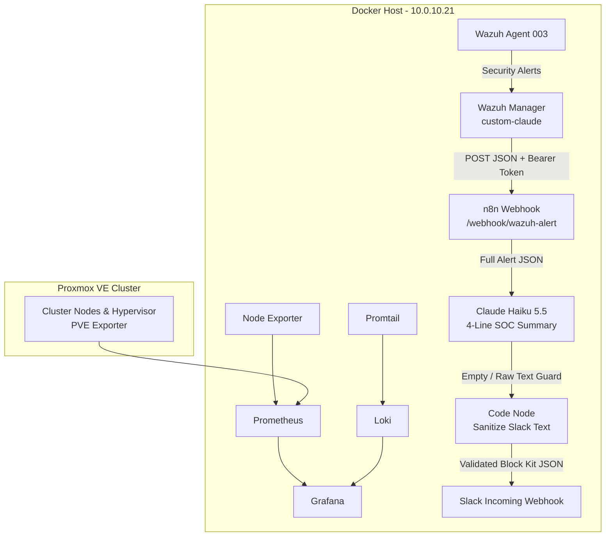

# ⚙️ SOC-Claude-Automation


**Ground-up homelab infrastructure and AI-assisted SOC triage pipeline built for the 2026 Q4 Homelab Workshop in partnership with the Claude Ambassador Program. Combines Proxmox VE clustering, Docker services, Prometheus/Grafana/Loki observability, and Wazuh SIEM alerts routed through n8n and Claude Haiku 5.5 into Slack.**

> **Spotlight:** Wazuh Agent (`10.0.10.21`) → `custom-claude` Integration → n8n Webhook → Claude Haiku 5.5 → Code Sanitizer → Slack

---

## 🌟 Claude Ambassador Program Partnership & Workshop Scope
Developed for the **2026 Q4 Homelab Workshop** in partnership with the **Claude Ambassador Program**, this repository captures both the **headline AI SOC triage automation** and the **full ground-up infrastructure build** required to run it reliably.

Rather than starting with a pre-built VM or cloud sandbox, the workshop walked through building the stack from scratch—provisioning Proxmox VE nodes, forming a cluster, deploying Docker and Portainer, standing up Prometheus, Grafana, Loki/Promtail, Node Exporter, and PVE Exporter, and wiring Wazuh alerts into Claude Haiku 5.5 for rapid 4-line SOC triage in Slack.

---

## 🏗️ The Philosophy: Ground-Up Resilience & Practical AI Triage
Alert fatigue slows down incident response when raw SIEM JSON blobs demand manual parsing for every event. At the same time, AI triage is only as trustworthy as the infrastructure and telemetry feeding it.

This architecture pairs **deterministic, low-latency AI log summarization** with **clean host and cluster observability**—prioritizing direct webhook integration, payload sanitization (`400 invalid_blocks` protection), and container persistence (`unless-stopped`) across power cycles.

---

## 🖥️ Full Workshop Stack & Infrastructure

### Ground-Up Infrastructure & Observability Stack
| Layer / Service | Role in Workshop | Notes |
| :--- | :--- | :--- |
| **Proxmox VE Cluster** | Hypervisor & multi-node clustering | Base virtualization & cluster management |
| **Docker Engine** | Container runtime (`10.0.10.21`) | Hosts n8n, monitoring stack, and utility containers |
| **Portainer CE** | Container management UI | Visual oversight of Docker containers and stacks |
| **Prometheus** | Metrics collection & time-series DB | Scrapes infrastructure and exporter targets |
| **Node Exporter** | Host-level Linux telemetry | CPU, memory, disk, and network metrics |
| **PVE Exporter** | Proxmox node & guest metrics | Cluster/hypervisor health visibility |
| **Grafana** | Dashboards & visual observability | Unified metrics and log visualization |
| **Loki & Promtail** | Log aggregation & log shipping | Centralized log collection alongside Wazuh |

### AI SOC Triage Pipeline Components
| Component | Specification / Role | Purpose |
| :--- | :--- | :--- |
| **Wazuh Agent `003`** | Wazuh v4.14.8 (`10.0.10.21`) | Local log collection & security rule evaluation |
| **Wazuh Integration** | `custom-claude` (`ossec.conf`) | Triggers on alert levels and posts JSON to n8n |
| **n8n Engine** | Self-Hosted Docker (`n8nio/n8n:latest`) | Webhook ingestion, prompt routing & formatting |
| **LLM Triage** | Claude Haiku 5.5 | Low-latency 4-line SOC incident summary |
| **Alert Channel** | Slack Incoming Webhook | Block Kit SOC incident notifications |

---

## 📐 Pipeline & Infrastructure Architecture



## AI SOC Triage Configuration (Highlight)

## 1. Claude Haiku 5.5 Request Payload

Pass the full incoming alert payload ({{ JSON.stringify($json) }}) instead of a missing sub-key so Claude always receives complete alert context:

```JSON
{
  "model": "claude-haiku-5-5",
  "max_tokens": 1000,
  "system": "You are an expert SOC analyst. Analyze the following Wazuh security alert and provide a concise 4-line summary: Severity/Risk, What Happened, Source/Target, and Recommended Action.",
  "messages": [
    {
      "role": "user",
      "content": "Here is the raw Wazuh alert JSON to analyze: {{ JSON.stringify($json) }}"
    }
  ]
}
```
## 2. Slack Block Kit Sanitization (Code Node)

Placed before the Slack HTTP Request node so empty or whitespace-only responses never trigger a 400 invalid_blocks error:

```
for (const item of $input.all()) {
  let analysisText = item.json.message || item.json.text || item.json.output || "";

  if (!analysisText || analysisText.trim() === "") {
    analysisText = "⚠️ AI triage completed, but no detailed summary text was returned.";
  }

  item.json.sanitizedText = analysisText;
}

return $input.all();
```

## 3. Docker Container Persistence After Reboot

Keep n8n and supporting services resilient across host reboots:

```Bash
docker start n8n
docker update --restart unless-stopped n8n
docker inspect n8n --format='{{.HostConfig.RestartPolicy.Name}}'
```

## 🧪 Verification & Testing Commands

Direct Webhook Connectivity Check

```Bash
curl -X POST [http://10.0.10.21:5678/webhook/wazuh-alert](http://10.0.10.21:5678/webhook/wazuh-alert) \
  -H "Authorization: Bearer <YOUR_TOKEN>" \
  -H "Content-Type: application/json" \
  -d '{"rule": {"id": "1002", "level": 10, "description": "Access denied test alert"}, "agent": {"name": "lab-web-01"}, "data": {"srcip": "10.0.10.50"}}'
```

Native Auth Failure Test (on 10.0.10.21)

```Bash
ssh invalid_user@127.0.0.1
Direct Integration Script Test
Bash
echo '{"rule": {"id": "5716", "level": 10, "description": "SSHD brute force attack detected"}, "agent": {"id": "003", "name": "docker"}, "data": {"srcip": "203.0.113.50"}}' > /tmp/test_alert.json
/var/ossec/integrations/custom-claude /tmp/test_alert.json
```

## 🛠️ Lessons Learned

Empty Slack Block Text (400 invalid_blocks): Slack rejects section blocks containing "" in text.mrkdwn. A pre-Slack Code node fallback keeps alerts flowing reliably.

Missing Nested Keys: Referencing an undefined property (such as $json.request) sends {} to Claude; passing {{ JSON.stringify($json) }} preserves the full payload.

Deduplication & Log Sources: Identical rapid logger lines can be deduplicated or miss /var/log/auth.log rules—use real auth failures, distinct test fields, or direct /var/ossec/integrations/custom-claude runs when validating end-to-end flow.

Docker Restart Policy: Containers in Exited (255) after a reboot need docker update --restart unless-stopped n8n so services return automatically on boot.

## 🤝 Connect & Dig Deeper

[sentinel-soc-automation](https://github.com/brypreez/sentinel-soc-automation) - Automated Active Response & Wazuh detection baseline.

[security-sentinel](https://github.com/brypreez/security-sentinel) - Kubernetes automated response and alerting.

[homelab](https://github.com/brypreez/homelab) - Infrastructure-as-Code modules and lab architecture.

Contact: Bryan Perez on LinkedIn: https://www.linkedin.com/in/bryan-perez-0b23822b4/ | Organization: CyberSentinels at Miami Dade College (in partnership with the Claude Ambassador Program).

## ⚖️ License
Distributed under the MIT License. See LICENSE for more information.
